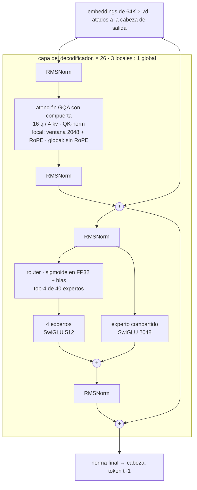
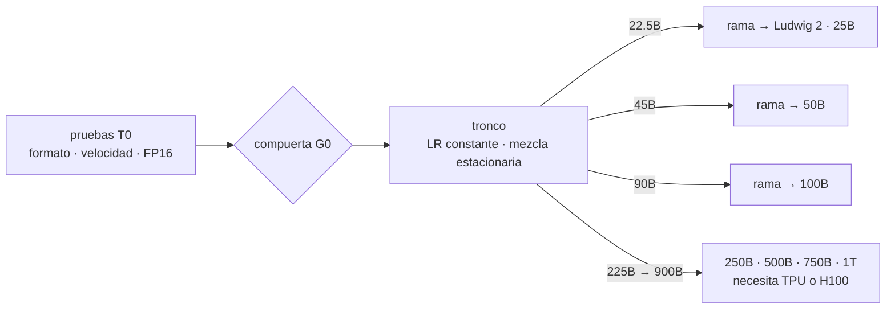

<div align="center">

# Ludwig 2

**Un modelo de lenguaje Mixture-of-Experts de 2B parámetros con 0.49B activos, entrenado desde cero en GPUs gratis de Kaggle y abierto hasta la última línea de log.**


[English](README.md) · **Español**

</div>

> **Estado, 12 de noviembre de 2026.** El diseño v1.2 está aprobado: Ludwig 2 se guarda en el formato AFMoE de los modelos Trinity de Arcee, que corre en llama.cpp sin parche. Un primer banco en 2×T4 midió **3,856 tokens/s, unas 1,800 h para 25B tokens**. Lo siguiente es la T0.2 v2, el entrenamiento real en 2×T4 ([notebook](notebooks/t0_2v2_afmoe_2xT4.ipynb)). **Todavía no hay pesos.** Este repositorio documenta el proyecto desde la primera prueba.

## Por qué Ludwig 2

- **Hecho para tu PC.** 0.49B parámetros activos por token, ~1.1 GB en 4 bits y una caché KV 3 veces más chica que con atención completa a 16K, porque 20 de sus 26 capas solo miran los últimos 2,048 tokens.
- **Entrenado con cómputo gratis.** Dos GPUs T4 de Kaggle, con un relevo entre amigos: cada uno corre sus turnos en su propia cuenta.
- **Inglés y español.** 10% de español en el preentrenamiento y 25–30% en el ajuste fino. [¿Por qué no 4% ni 50%?](#por-qué-10-de-español)
- **Razona, a su escala.** `<think>` desde el día uno, 10–22% de matemática, Python como calculadora y ajuste fino con cadenas de pensamiento cortas.
- **Abierto de punta a punta:** pesos, código, la receta de datos con manifiestos exactos, logs completos, checkpoints intermedios y lo que salió mal.

## El modelo

| | |
|---|---|
| Parámetros | **1.906B totales, 0.491B activos** por token |
| Forma | 26 capas × ancho 1024: la primera es densa y las otras 25 son MoE |
| Atención | GQA (16 cabezas de query y 4 de KV, de 64), QK-norm, compuerta sigmoide a la salida |
| Capas locales y globales | 3 capas locales (ventana deslizante de 2,048 tokens, RoPE θ = 10K) por cada global (sin codificación de posición): 20 locales y 6 globales |
| FFN | 40 expertos (SwiGLU 512), top-4, + 1 experto compartido (SwiGLU 2048). La primera capa, densa, es un SwiGLU 4096 |
| Router | Sigmoide en FP32 con un bias por experto que actualiza SMEBU (el balanceo no necesita pérdida auxiliar), más una pérdida pequeña por secuencia. No descarta tokens |
| Normas | Sándwich escalada por profundidad: una RMSNorm antes y otra después de cada subcapa |
| Vocabulario | 64K, BPE propio, embeddings atados (multiplicados por √d a la entrada) |
| Contexto | 2K → 4K en el tronco, 16K en la v1, 32K desde 250B tokens |
| Tamaño | ~2.0 GB en Q8_0, ~1.1 GB en Q4_0. Caché KV de 136 MiB a 16K, contra 416 MiB si todas las capas fueran globales |
| Formato | `AfmoeForCausalLM` de Hugging Face (Arcee Trinity) → GGUF con llama.cpp sin cambios |



### De dónde sale

Ludwig 2 toma la **forma** de MobileMoE-M de Meta (profunda y delgada) y el **bloque** de Trinity Nano de Arcee, un MoE de 6B totales y 1B activos con el mismo ancho de 1024, entrenado con Muon sobre 10T tokens. Frente a MobileMoE-M:

| | MobileMoE-M (Meta) | Ludwig 2 |
|---|---|---|
| Forma | 26 × 1024, GQA 16/4 | Igual |
| Totales / activos | 2.82B / 528M | 1.91B / 491M |
| Vocabulario | 128K (Llama 3) | 64K: la cabeza a la mitad |
| QK-norm y compuerta | No las menciona | Las dos |
| Router | Sigmoide sin pérdida auxiliar | Sigmoide con un bias por experto que actualiza SMEBU |
| Optimizador y schedule | AdamW, coseno | Muon, WSD |
| Precisión | BF16 | FP16 (T4) con el residuo en FP32 |
| Tokens de entrenamiento | ~6T + 500B de mid-training | 25B (v1) → 1T |
| Contexto | 8K | 16K → 32K |
| Dónde corre | ExecuTorch, con una op propia | transformers y llama.cpp sin cambios |

Meta entrenó ~260 veces más tokens que nuestra v1. Por eso la v1 se compara por tokens contra checkpoints intermedios públicos (por ejemplo OLMoE y Pythia a ~25B tokens), no de tú a tú con MobileMoE-M.

## Programa de entrenamiento

Un solo tronco con learning rate constante y una mezcla de datos estacionaria. Cada versión pública es una rama corta de enfriamiento que sale del tronco, y el tronco sigue.



| Versión | Tokens nuevos | Horas de 2×T4 | Semanas de relevo |
|---|---|---|---|
| Ludwig 2 · 25B | 25B | 1,750–2,800 | 12–20 |
| Ludwig 2 · 50B | 27.5B | 1,900–3,000 | 13–21 |
| Ludwig 2 · 100B | 55B | 4,200–6,600 | 29–46 |
| 250B → 1T | 1,060B | Fuera del alcance de Kaggle | ~2,100–3,700 h de TPU v5e-8 para el programa completo |

Antes de cada fase nueva tienen que pasar cinco revisiones: la versión anterior publicada, la pérdida de validación en su curva esperada, los expertos sanos, sin memorización en las fuentes que se repiten, y hardware para la fase completa. **1T es una meta, no una obligación**: cada versión hasta 100B se puede publicar por sí sola. Detalles en [`docs/es/DISENO.md`](docs/es/DISENO.md) §7.

## Resultados hasta ahora

### T0.1: el primer formato (CPU, 11 de noviembre de 2026)

La v1.1 guardaba el modelo como `Qwen3NextForCausalLM` con todas las capas en atención completa (formato A). Un modelo diminuto en ese formato se convierte a GGUF, pero **llama.cpp sin cambios se cae al cargarlo**: trata `qwen3next` como híbrido aunque ninguna capa sea recurrente, y falla en un buffer que nunca se asignó (`GGML_ASSERT(buffer)`). Con un parche de 3 líneas todo pasa: probabilidades a 1.9e-6, greedy 4/4 y MTP especulativo 4/4 ([`patches/README.md`](patches/README.md), [`results/t0_1_stock.json`](results/t0_1_stock.json), [`results/t0_1_patched.json`](results/t0_1_patched.json)). Un modelo que solo corre en un llama.cpp parchado no corre en Ollama ni en LM Studio, así que la v1.2 pasó a un formato que no necesita parche.

### Banco v1: velocidad y memoria en 2×T4 (Kaggle, 11 de noviembre de 2026)

Una implementación aparte en PyTorch con la misma forma ([`results/banco_t4_v1/banco_t4_v1.py`](results/banco_t4_v1/banco_t4_v1.py)), con FSDP2, FP16 y Muon, sobre datos aleatorios y un entrenamiento corto sintético:

| | Resultado |
|---|---|
| 26 × 1024, 40 expertos, 8 secuencias de 2K por GPU | **3,856 tokens/s**, pico 13.2 GiB (13.8 reservados), **1,801 h para 25B tokens** |
| Formas más anchas (16 × 1280, 11 × 1536, 6 × 2048) | Como mucho 1.11× más rápidas: la profundidad se queda |
| 48 / 60 expertos | −24% / −31% de velocidad: se quedan 40 |
| Ancho de banda entre las dos T4 | 3.2 GB/s |
| 60 pasos de entrenamiento en FP16 | Pérdida 11.27 → 1.79, sin pasos saltados ni NaN; pero el experto más cargado llegó a 8.4× el promedio |

Salida cruda: [`results/banco_t4_v1/`](results/banco_t4_v1/). Lo que deja decidido y lo que no: [`docs/es/BITACORA.md`](docs/es/BITACORA.md).

### T0.1-C: el formato AFMoE (CPU, 11 de noviembre de 2026)

Un `AfmoeForCausalLM` diminuto con la estructura de Ludwig 2, con prompts más largos que su ventana deslizante y un bias de expertos grande a propósito, coincide con transformers en llama.cpp **sin cambios**: probabilidades a 5.9e-5, greedy 4/4 y el bias de los expertos respetado ([`scripts/smoke_format_afmoe.py`](scripts/smoke_format_afmoe.py), [`results/t0_1c_afmoe.json`](results/t0_1c_afmoe.json)). Para eso son obligatorias dos opciones: `mup_enabled` (llama.cpp siempre multiplica los embeddings por √d) y `route_norm`.

### T0.2 v2: el entrenamiento real en 2×T4

⏳ Lista para correr: [`notebooks/t0_2v2_afmoe_2xT4.ipynb`](notebooks/t0_2v2_afmoe_2xT4.ipynb), ~1–1.25 h. Entrena el modelo real de 1.906B con la clase de transformers más nuestras piezas de velocidad: expertos con bmm y relleno, residuo en FP32, gradientes en FP16 entre las GPUs, prefetch de FSDP2 y, como opción, el momento de Muon en la RAM. Quita cada pieza una vez para medir cuánto vale. También mide 4K y 16K de contexto, el guardado y la carga del checkpoint completo, y 60 pasos de entrenamiento que comparan SMEBU contra el bias de signo fijo.

## Datos

| | Web en inglés | Código | Matemática | Conocimiento | Libros sintéticos | Español | Instrucción y razonamiento |
|---|---|---|---|---|---|---|---|
| **Tronco** | 50% | 20% | 10% | 5% | 3% | 10% | 2% |
| **Ramas** | 26% | 25% | 22% | 4% | — | 10% | 13% |

- **Fuentes:** FineWeb-Edu y DCLM; Stack-Edu o The Stack v3 (sobre todo Python y JS/TS); FineMath, OpenWebMath y MegaMath; Wikipedia, arXiv y StackExchange; Cosmopedia; FineWeb2 y TransWeb-Edu en español; OpenMathReasoning para las trazas.
- **Licencias:** solo texto humano abierto y salidas de modelos abiertos con licencia permisiva. **Nunca salidas de APIs cerradas.** Los pesos se publican solo después de auditar la ficha de datos fuente por fuente.
- **Datos sintéticos:** con tope de 10% del tronco y 35% de cada rama, de al menos 3 familias de maestros.
- **Descontaminación** contra los benchmarks con filtros de Bloom de 13-gramas; el val de cada fuente nunca se entrena.

### Por qué 10% de español

- **No 50/50.** En experimentos controlados, un idioma dominante ayuda al menos frecuente, y a escala una mezcla 90/10 le ganó a la 50/50 en *los dos* idiomas. Además, el inglés tiene los mejores datos y casi todos los benchmarks.
- **No 4%.** Serían ~1B tokens de español en la v1: muy poco para que converse bien.
- **10%** da ~2.5B tokens de español en la v1 y ~90B a 1T, más o menos 86/14 en lenguaje natural. SmolLM3 usó una proporción parecida (12% multilingüe) y le fue bien en español.
- Se mide con bits por byte en español, MGSM, Belebele, Global-MMLU, HellaSwag y Flores. Si el español se queda atrás, las ramas lo suben sin tocar el tronco.

## Cómo empezar

### Correr las pruebas en tu máquina (CPU)

```bash
git clone https://github.com/FelipeGarciaRpo/ludwig-lm && cd ludwig-lm
pip install -r requirements.txt

# T0.1-C: el formato AFMoE contra llama.cpp (la primera vez clona y compila llama.cpp, ~15–25 min)
python scripts/smoke_format_afmoe.py

# El entrenamiento (FSDP2, Muon, balanceo, checkpoint), 2 procesos en CPU con un modelo diminuto
torchrun --nproc_per_node 2 scripts/bench_afmoe.py --config configs/tiny_afmoe.json \
    --seq 64 --micro 2 --steps 2 --ckpt-test --out /tmp/t0_2v2_cpu.jsonl
```

### Correrlas en Kaggle

| Notebook | Acelerador | Tiempo | Qué sale |
|---|---|---|---|
| [`t0_2v2_afmoe_2xT4.ipynb`](notebooks/t0_2v2_afmoe_2xT4.ipynb) | GPU T4 x2 | ~1–1.25 h | `results/t0_2v2.jsonl` |
| [`t0_1_formato_mtp_tokenizador.ipynb`](notebooks/t0_1_formato_mtp_tokenizador.ipynb) | None (CPU) | ~15–25 min | Pruebas del formato A y del **tokenizador**; ya solo importa la del tokenizador |

En cada notebook pon `REPO_URL` con la URL de tu repo (o sube el repo como dataset de Kaggle y déjalo vacío), activa **Internet** y corre todas las celdas. Para tener Internet, la cuenta de Kaggle debe estar verificada con teléfono. `t0_2_velocidad_memoria_2xT4.ipynb` medía el formato A y queda solo como registro.

## Repositorio

```
ludwig-lm/
├── ludwig_lm/      # afmoe.py: el modelo (AFMoE), su kernel, pérdidas y balanceo · muon.py · model.py: formato A (respaldo)
├── configs/        # ludwig2_afmoe.json (el modelo real), tiny_afmoe.json (pruebas); ludwig2.json, tiny.json (formato A)
├── scripts/        # smoke_format_afmoe.py (T0.1-C), bench_afmoe.py (T0.2 v2), make_notebooks.py, convert_gguf.py, lo del formato A
├── notebooks/      # notebooks de Kaggle, generados con scripts/make_notebooks.py
├── patches/        # parche de llama.cpp para el formato A y su nota técnica
├── results/        # reportes crudos de cada prueba: la evidencia de cada afirmación
└── docs/           # DECISIONS.md (inglés), es/DISENO.md (diseño completo), es/BITACORA.md (bitácora de cada corrida)
```

## Hoja de ruta de la v1

- [x] Diseño v1.1, después de una crítica externa ([`docs/es/DISENO.md`](docs/es/DISENO.md))
- [x] **T0.1** Formato A: llama.cpp sin cambios se cae; con el parche pasa
- [x] **Banco v1** en 2×T4: 3,856 tokens/s, forma y número de expertos confirmados
- [x] **T0.1-C** Formato AFMoE: pasa en llama.cpp sin cambios
- [x] **v1.2** Formato AFMoE aprobado
- [ ] **T0.2 v2** El entrenamiento real en 2×T4 ([notebook](notebooks/t0_2v2_afmoe_2xT4.ipynb))
- [ ] **T0.1b** Repetir las pruebas del tokenizador con el tokenizador final de 64K
- [ ] **T0.3** Estabilidad en FP16: 2–3K pasos con el LR pico
- [ ] **T1** Datos: fuente de código, lector determinista con descontaminación y manifiestos
- [ ] **T2** Learning rate: 3 corridas cortas
- [ ] **G0** Compuerta: ≥6 h sostenidas, guardado, reanudación en otra cuenta, 16K
- [ ] **T3** Tronco hasta 22.5B tokens
- [ ] **T4** Rama de la v1: 2.5B tokens, 16K
- [ ] **T5** SFT, GGUF y evaluación: **Ludwig 2 · 25B publicado**

## Cómo ayudar

- **Presta horas de T4.** Corre turnos del relevo en *tu propia* cuenta de Kaggle con el notebook del relevo (llega con la T3). Nunca compartas credenciales.
- **Español.** Fuentes de datos, conjuntos de evaluación y revisión de las salidas por hablantes nativos.
- **Motores.** Prueba el GGUF en MLX, vLLM, Ollama o LM Studio cuando exista.
- **Revisión.** Los issues con preguntas o críticas son bienvenidos, y las estrellas también.

## Documentación

- [`docs/es/DISENO.md`](docs/es/DISENO.md): el documento de diseño completo, con números y fuentes.
- [`docs/DECISIONS.md`](docs/DECISIONS.md): cada decisión, por qué y la evidencia (en inglés).
- [`docs/es/BITACORA.md`](docs/es/BITACORA.md): cada corrida y cada decisión, en orden.
- [`patches/README.md`](patches/README.md): la caída de llama.cpp con el formato A, su causa y el arreglo (en inglés).

## El nombre

Por Ludwig Boltzmann. Ludwig 2 es el segundo modelo de la familia: Ludwig 1 es un modelo denso de ~200M entrenado con 8B tokens, y Ludwig 2 reutiliza su learning rate y su lector de datos.

## Licencia

Código: [Apache-2.0](LICENSE). Pesos: el plan es Apache-2.0, y se decide en cada versión después de auditar las licencias de los datos.

## Cita

```bibtex
@software{ludwig2_2026,
  author = {García, Felipe},
  title  = {Ludwig 2: a 2B-parameter open MoE language model trained on free GPUs},
  year   = {2026},
  note   = {https://github.com/FelipeGarciaRpo/ludwig-lm}
}
```

## Agradecimientos

Construido sobre [PyTorch](https://pytorch.org), [transformers](https://github.com/huggingface/transformers) y [llama.cpp](https://github.com/ggml-org/llama.cpp). El diseño se apoya en trabajos publicados por Meta (MobileMoE, MobileLLM-R1), Arcee (Trinity y su bloque AFMoE), Qwen (atención con compuerta), DeepSeek (balanceo sin pérdida auxiliar, R1), Moonshot AI (Muon a escala) y Hugging Face (FineWeb, SmolLM). La lista completa de fuentes está en [`docs/es/DISENO.md`](docs/es/DISENO.md) §13.
