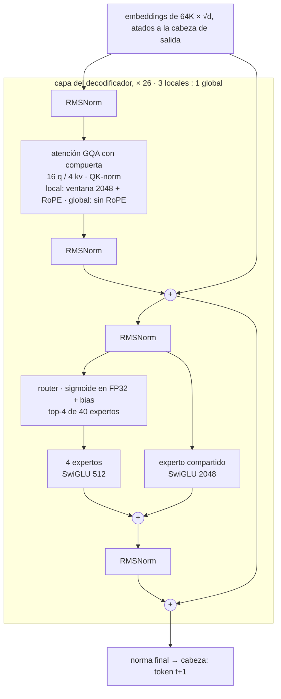
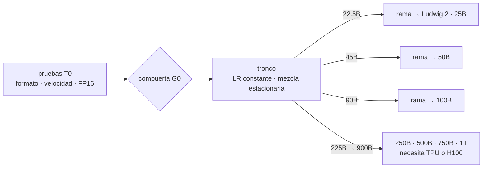

<div align="center">

# Ludwig 2

**Un modelo de lenguaje Mixture-of-Experts de 2B parámetros con 0.49B activos, entrenado desde cero en GPUs gratis de Kaggle y abierto hasta la última línea de log.**


[English](README.md) · **Español**

</div>

> **Estado, 25 de noviembre de 2026.** El diseño v1.2 está aprobado: Ludwig 2 se guarda en el formato AFMoE de los modelos Trinity de Arcee, que corre en llama.cpp sin parche. El tronco arrancó el 18 de noviembre, por turnos entre cuentas de Kaggle (checkpoints en Hugging Face con candado y respaldo en Kaggle, [notebook](notebooks/tronco_relevo_2xT4.ipynb)), y pasó la compuerta G0. Desde el paso ~1,250, el balanceo de los expertos se rompió en las primeras 5 capas MoE, donde el sesgo de balanceo terminó eligiendo los expertos de todos los tokens. Empezó cuando bajó el nivel del router, y el z-loss del router lo aceleró ([`docs/DECISIONS.md`](docs/DECISIONS.md), P29–P31). El 25 de noviembre el tronco volvió a empezar desde el paso 0 sin esa pérdida, con el paso del sesgo 10 veces más chico desde el paso 500 y una parada si el balanceo se rompe. Después del primer turno de esa corrida, vuelve a empezar una vez más como `tronco3`, con 3 capas densas antes de la primera capa MoE en vez de 1, como hace DeepSeek-V3 y como hizo Trinity Large para arreglar el mismo colapso (P32). Así el modelo queda en 1.793B parámetros totales, con los mismos 0.491B activos. El entrenamiento va a **3,300–3,600 tokens/s en 2×T4, ~1,900–2,100 h para 25B tokens**, con ×1, el learning rate del Ludwig 1. El tokenizador de 64K quedó fijado ([`tokenizer/`](tokenizer/)), y los datos del tronco son shards pre-tokenizados en la CPU de Kaggle ([notebook](notebooks/t1_shards_cpu.ipynb)). **Todavía no hay pesos.** Este repositorio documenta el proyecto desde la primera prueba.

## Por qué Ludwig 2

- **Hecho para tu PC.** 0.49B parámetros activos por token, ~1.1 GB en 4 bits y una caché KV 3 veces más chica que con atención completa a 16K, porque 20 de sus 26 capas solo miran los últimos 2,048 tokens.
- **Entrenado con cómputo gratis.** Dos GPUs T4 de Kaggle, con un relevo entre amigos: cada uno corre sus turnos en su propia cuenta.
- **Inglés y español.** 24% de español en el tronco, 60/40 con el inglés en lenguaje natural, y 25–30% en el ajuste fino. [¿Por qué 24%?](#por-qué-24-de-español)
- **Razona, a su escala.** `<think>` desde el día uno, 10–22% de matemática, Python como calculadora y ajuste fino con cadenas de pensamiento cortas.
- **Abierto de punta a punta:** pesos, código, la receta de datos con manifiestos exactos, logs completos, checkpoints intermedios y lo que salió mal.

## El modelo

| | |
|---|---|
| Parámetros | **1.793B totales, 0.491B activos** por token (3 capas densas desde la P32; 1.906B con 1) |
| Forma | 26 capas × ancho 1024: la primera es densa y las otras 25 son MoE |
| Atención | GQA (16 cabezas de query y 4 de KV, de 64), QK-norm, compuerta sigmoide a la salida |
| Capas locales y globales | 3 capas locales (ventana deslizante de 2,048 tokens, RoPE θ = 10K) por cada global (sin codificación de posición): 20 locales y 6 globales |
| FFN | 40 expertos (SwiGLU 512), top-4, + 1 experto compartido (SwiGLU 2048). La primera capa, densa, es un SwiGLU 4096 |
| Router | Sigmoide en FP32 con un bias por experto que actualiza SMEBU (el balanceo no necesita pérdida auxiliar), más una pérdida pequeña por secuencia. No descarta tokens |
| Normas | Sándwich escalada por profundidad: una RMSNorm antes y otra después de cada subcapa |
| Vocabulario | 64K, BPE propio, embeddings atados (multiplicados por √d a la entrada) |
| Contexto | 2K → 4K en el tronco, 16K en la v1, 32K desde 250B tokens |
| Tamaño | ~2.0 GB en Q8_0, ~1.1 GB en Q4_0. Caché KV de 136 MiB a 16K, contra 416 MiB si todas las capas fueran globales |
| Formato | `AfmoeForCausalLM` de Hugging Face (Arcee Trinity) → GGUF con llama.cpp sin cambios |



### De dónde sale

Ludwig 2 toma la **forma** de MobileMoE-M de Meta (profunda y delgada) y el **bloque** de Trinity Nano de Arcee, un MoE de 6B totales y 1B activos con el mismo ancho de 1024, entrenado con Muon sobre 10T tokens. Frente a MobileMoE-M:

| | MobileMoE-M (Meta) | Ludwig 2 |
|---|---|---|
| Forma | 26 × 1024, GQA 16/4 | Igual |
| Totales / activos | 2.82B / 528M | 1.79B / 491M |
| Vocabulario | 128K (Llama 3) | 64K: la cabeza a la mitad |
| QK-norm y compuerta | No las menciona | Las dos |
| Router | Sigmoide sin pérdida auxiliar | Sigmoide con un bias por experto que actualiza SMEBU |
| Optimizador y schedule | AdamW, coseno | Muon, WSD |
| Precisión | BF16 | FP16 (T4) con el residuo en FP32 |
| Tokens de entrenamiento | ~6T + 500B de mid-training | 25B (v1) → 1T |
| Contexto | 8K | 16K → 32K |
| Dónde corre | ExecuTorch, con una op propia | transformers y llama.cpp sin cambios |

Meta entrenó ~260 veces más tokens que nuestra v1. Por eso la v1 se compara por tokens contra checkpoints intermedios públicos (por ejemplo OLMoE y Pythia a ~25B tokens), no de tú a tú con MobileMoE-M.

## Programa de entrenamiento

Un solo tronco con learning rate constante y una mezcla de datos estacionaria. Cada versión pública es una rama corta de enfriamiento que sale del tronco, y el tronco sigue.



| Versión | Tokens nuevos | Horas de 2×T4 | Semanas de relevo |
|---|---|---|---|
| Ludwig 2 · 25B | 25B | 1,750–2,800 | 12–20 |
| Ludwig 2 · 50B | 27.5B | 1,900–3,000 | 13–21 |
| Ludwig 2 · 100B | 55B | 4,200–6,600 | 29–46 |
| 250B → 1T | 1,060B | Fuera del alcance de Kaggle | ~2,100–3,700 h de TPU v5e-8 para el programa completo |

Antes de cada fase nueva tienen que pasar cinco revisiones: la versión anterior publicada, la pérdida de validación en su curva esperada, los expertos sanos, sin memorización en las fuentes que se repiten, y hardware para la fase completa. **1T es una meta, no una obligación**: cada versión hasta 100B se puede publicar por sí sola. Detalles en [`docs/es/DISENO.md`](docs/es/DISENO.md) §7.

## Resultados hasta ahora

### T0.1: el primer formato (CPU, 11 de noviembre de 2026)

La v1.1 guardaba el modelo como `Qwen3NextForCausalLM` con todas las capas en atención completa (formato A). Un modelo diminuto en ese formato se convierte a GGUF, pero **llama.cpp sin cambios se cae al cargarlo**: trata `qwen3next` como híbrido aunque ninguna capa sea recurrente, y falla en un buffer que nunca se asignó (`GGML_ASSERT(buffer)`). Con un parche de 3 líneas todo pasa: probabilidades a 1.9e-6, greedy 4/4 y MTP especulativo 4/4 ([`patches/README.md`](patches/README.md), [`results/t0_1_stock.json`](results/t0_1_stock.json), [`results/t0_1_patched.json`](results/t0_1_patched.json)). Un modelo que solo corre en un llama.cpp parchado no corre en Ollama ni en LM Studio, así que la v1.2 pasó a un formato que no necesita parche.

### Banco v1: velocidad y memoria en 2×T4 (Kaggle, 11 de noviembre de 2026)

Una implementación aparte en PyTorch con la misma forma ([`results/banco_t4_v1/banco_t4_v1.py`](results/banco_t4_v1/banco_t4_v1.py)), con FSDP2, FP16 y Muon, sobre datos aleatorios y un entrenamiento corto sintético:

| | Resultado |
|---|---|
| 26 × 1024, 40 expertos, 8 secuencias de 2K por GPU | **3,856 tokens/s**, pico 13.2 GiB (13.8 reservados), **1,801 h para 25B tokens** |
| Formas más anchas (16 × 1280, 11 × 1536, 6 × 2048) | Como mucho 1.11× más rápidas: la profundidad se queda |
| 48 / 60 expertos | −24% / −31% de velocidad: se quedan 40 |
| Ancho de banda entre las dos T4 | 3.2 GB/s |
| 60 pasos de entrenamiento en FP16 | Pérdida 11.27 → 1.79, sin pasos saltados ni NaN; pero el experto más cargado llegó a 8.4× el promedio |

Salida cruda: [`results/banco_t4_v1/`](results/banco_t4_v1/). Lo que deja decidido y lo que no: [`docs/es/BITACORA.md`](docs/es/BITACORA.md).

### T0.1-C: el formato AFMoE (CPU, 11 de noviembre de 2026)

Un `AfmoeForCausalLM` diminuto con la estructura de Ludwig 2, con prompts más largos que su ventana deslizante y un bias de expertos grande a propósito, coincide con transformers en llama.cpp **sin cambios**: probabilidades a 5.9e-5, greedy 4/4 y el bias de los expertos respetado ([`scripts/smoke_format_afmoe.py`](scripts/smoke_format_afmoe.py), [`results/t0_1c_afmoe.json`](results/t0_1c_afmoe.json)). Para eso son obligatorias dos opciones: `mup_enabled` (llama.cpp siempre multiplica los embeddings por √d) y `route_norm`. El 25 de noviembre la misma prueba pasó con 3 capas densas en vez de 1, el único cambio que la P32 le hace al modelo real: probabilidades a 4.0e-6 y greedy 4/4 ([`configs/tiny_afmoe_d3.json`](configs/tiny_afmoe_d3.json), [`results/t0_1c_afmoe_d3.json`](results/t0_1c_afmoe_d3.json)).

### T0.2 v2: el entrenamiento real en 2×T4 (Kaggle, 12 de noviembre de 2026)

El modelo real de 1.906B en la clase de transformers, FSDP2 entre las dos T4, FP16, Muon + AdamW, las pérdidas de balanceo y el bias de los expertos, con datos sintéticos ([`notebooks/t0_2v2_afmoe_2xT4.ipynb`](notebooks/t0_2v2_afmoe_2xT4.ipynb), [`results/t0_2v2_intento2/`](results/t0_2v2_intento2/)). Cada pieza de velocidad se quitó una vez frente a la base:

| Medición | tokens/s | Frente a la base | Pico reservado |
|---|---|---|---|
| Base: bmm con relleno, residuo FP32, gradientes FP16, prefetch, 8 secuencias de 2K por GPU | 2,930 | — | 14.33 GiB |
| Un matmul por experto (un loop) | 3,436 | +17.3% | 14.30 GiB |
| Momento de Muon en la RAM de la CPU | 2,831 | −3.4% | 12.76 GiB |
| Residuo en FP16 | 2,918 | −0.4% | 13.67 GiB |
| Gradientes en FP32 entre las GPUs | 2,762 | −5.7% | 14.33 GiB |
| Sin prefetch | 2,734 | −6.7% | 14.33 GiB |
| 4 secuencias por GPU | 2,242 | −23.5% | 12.77 GiB |
| 4K / 16K de contexto | 2,240 / 1,228 | | 14.33 GiB |

- **Configuración del entrenamiento:** el loop más el momento en la RAM. Medidos por separado, juntos deberían dar ~3,300 tokens/s (~2,100 h para 25B tokens) con ~12.7 GiB reservados, bajo el tope de 13.5 GiB de la compuerta G0.
- **Checkpoint:** 11.29 GiB, se guarda en 54 s y se carga en 48 s, y se restaura exacto.
- **Balanceo,** 60 pasos de texto sintético: SMEBU con λ = 0.01 dejó al experto más cargado en 2.41× el promedio; el bias de signo fijo del banco v1, en 7.57×. Ninguna medición saltó un paso en FP16.

### T0.3 + T2: learning rate y estabilidad en FP16 (Kaggle, 13–15 de noviembre de 2026)

El modelo real con el bucle de entrenamiento real ([`scripts/train.py`](scripts/train.py)), con ×0.5, ×1 y ×2 los learning rates del Ludwig 1 (Muon 1.5e-3, AdamW 5e-4): 400 pasos de 0.25M tokens cada una (~105M tokens), una por cuenta de Kaggle, en paralelo ([`notebooks/t0_3_t2_lr_2xT4.ipynb`](notebooks/t0_3_t2_lr_2xT4.ipynb), [`results/t0_3_t2/`](results/t0_3_t2/)). Mientras se termina el tokenizador de 64K usan FineWeb-Edu y el tokenizador de SmolLM2, y se comparan en bits por byte.

| | ×0.5 | ×1 (Ludwig 1) | ×2 |
|---|---|---|---|
| Validación, bits por byte, después del enfriamiento | 1.3470 | 1.2223 | **1.1516** |
| tokens/s, última hora | 3,601 | 3,428 | 3,293 |
| Experto más cargado en una ventana de 50 pasos, el peor desde el paso 150 | 1.24× | 1.60× | 4.22× (paso 320); 1.11× en el paso 400 |

- **Estables:** sin NaN, sin pasos saltados, escala de FP16 fija en 32,768, 12.92 GiB reservados y la prueba de guardado y reanudación exacta, bit a bit, en las tres.
- **×2 gana en el horizonte corto,** pero las corridas cortas favorecen los LR altos: el mejor LR baja cuando el entrenamiento es más largo.
- **La segunda ronda lo midió:** ×4 a 400 pasos, y ×1 y ×2 seguidas con el LR fijo.
  - ×4 es la mejor a 400 pasos (1.1284), pero su balanceo de expertos diverge en vez de converger.
  - En el mismo paso, la ventaja de ×2 sobre ×1 baja de 6.65% en el paso 300 a 1.01% en el 800.
  - ×1 llega a 1.0094 en el paso 1,100, dentro de su enfriamiento.
- **El tronco entrena con ×1, la receta del Ludwig 1:** es lo que da la regla decidida de antemano ([`scripts/lr_horizon.py`](scripts/lr_horizon.py); [`docs/DECISIONS.md`](docs/DECISIONS.md), P9 y P25).
- **Visto después (P29):** las dos corridas de 1,200 pasos tenían el balanceo de los expertos roto antes del paso 800 (×1 desde el 544, ×2 desde el 470), por el mismo z-loss del router que rompió el primer tronco. ×1 se queda, porque es la opción segura.
- **Dos corridas idénticas difieren ≤0.11%** después de 300 pasos, porque las sumas en la GPU no se repiten bit a bit. Esto no afecta las verificaciones de la reanudación (P28).
- **Las diferencias de velocidad son de las máquinas,** no del LR: dentro de cada corrida la velocidad no cambia con la carga de los expertos.

### El tokenizador de 64K (CPU de Kaggle, 14 de noviembre de 2026)

BPE a nivel de bytes con 65,536 tokens y la regex de corte de Qwen2, entrenado en 56 minutos con una muestra de 1.2 GB de las 23 fuentes de la mezcla del tronco ([`tokenizer/`](tokenizer/), [`results/tokenizador_64k/con_transweb/`](results/tokenizador_64k/con_transweb/)):

| | Ludwig 2 (64K) | SmolLM2 (49K) | OLMoE (50K) | Qwen3 (151K) |
|---|---|---|---|---|
| Bytes por token, mezcla del tronco | **4.159** | 3.551 | 3.719 | 4.034 |
| Bytes por token, español | **4.598** | 2.934 | 3.350 | 3.790 |
| Tokens por palabra, inglés / español | 1.37 / 1.33 | 1.38 / 2.08 | 1.36 / 1.83 | 1.35 / 1.61 |

- **Texto que nunca vio:** en los documentos y el código de este repositorio usa 20% menos tokens que SmolLM2 en español, 7% menos en inglés y 12% menos en Python.
- **llama.cpp (T0.1b):** en el formato AFMoE, 17 de 17 textos de prueba tokenizan igual que en Hugging Face, y llama.cpp detecta todos los ids especiales ([`results/t0_1b_tokenizer.json`](results/t0_1b_tokenizer.json)). El hash del vocabulario es nuevo para llama.cpp, así que por ahora los GGUF se convierten con [`scripts/convert_gguf.py`](scripts/convert_gguf.py).

## Datos

| | Web en inglés | Código | Matemática | Conocimiento | Libros sintéticos | Español | Instrucción y razonamiento |
|---|---|---|---|---|---|---|---|
| **Tronco** (mezcla v3) | 31% | 28% | 10% | 3% | 2% | 24% | 2% |
| **Ramas** | 26% | 25% | 22% | 4% | — | 10% | 13% |

- **Fuentes:**
  - Inglés: FineWeb-Edu y DCLM (sin duplicados), FinePhrase, Wikipedia, StackExchange y Cosmopedia.
  - Español: FineWeb2-HQ, TransWeb-Edu, Wikipedia y texto paralelo de la ONU y Europarl.
  - Código: los archivos de Stack-Edu con licencia permisiva, con el contenido de Common Pile; The Stack v1 para HTML y CSS; notebooks de StarCoderData; Stack Overflow.
  - Matemática: FineMath 4+ e InfiWebMath 4+.
  - Instrucción: OpenMathReasoning y OpenAssistant.

  La tabla completa está en [`docs/es/DISENO.md`](docs/es/DISENO.md) (4.2–4.4), y la revisión que la respalda, en [`results/datos_tronco_v3/`](results/datos_tronco_v3/).
- **Licencias:** solo texto humano abierto y salidas de modelos abiertos con licencia permisiva. **Nunca salidas de APIs cerradas.** Los pesos se publican solo después de auditar la ficha de datos fuente por fuente.
- **Texto escrito por modelos:** con topes por tipo en el tronco (generación libre ≤5%, reescritura ≤10%, traducción ≤10%, ≤20% en total; la v3 queda en 18.5%) y de 35% en cada rama, de al menos 3 familias de maestros.
- **Descontaminación** contra 16 benchmarks en inglés y español, con hashes exactos de 13-gramas de tokens. Los documentos de validación de cada fuente nunca se entrenan.
- **Pre-tokenizado una sola vez (T1)** en shards de 256 MiB de ids uint16, con un manifiesto de hashes ([`scripts/build_shards.py`](scripts/build_shards.py), receta en [`configs/data_v3.json`](configs/data_v3.json)):
  - las etiquetas de fuente de MeCo, fuera de la pérdida;
  - FIM en el 10% del código;
  - la plantilla de chat, con `<think>` como token, en las trazas de razonamiento.

  Construidos en una sesión o en varias, los shards salen idénticos byte a byte.

### Por qué 24% de español

- **La meta es un modelo totalmente bilingüe.** Con 24% del tronco, el lenguaje natural queda 60/40 entre inglés y español: ~5.4B tokens de español en el tronco de la v1.
- **No 90/10.** Que un idioma dominante ayude al otro, y que 90/10 le ganara a 50/50, viene de experimentos con idiomas clonados. El precedente de un modelo chico bilingüe de verdad es CroissantLLM (1.3B), entrenado con inglés y francés 1:1. A SmolLM3 le fue bien en español con 12% de web multilingüe.
- **El costo:** la web en inglés escrita por personas baja a 25% del tronco.
- **Se mide** con bits por byte por dominio desde el paso 0, más MGSM, Belebele, Global-MMLU, HellaSwag y Flores. Si el español se queda atrás, las ramas lo suben sin tocar el tronco.

## Cómo empezar

### Correr las pruebas en tu máquina (CPU)

```bash
git clone https://github.com/FelipeGarciaRpo/ludwig-lm && cd ludwig-lm
pip install -r requirements.txt

# T0.1-C: el formato AFMoE contra llama.cpp (la primera vez clona y compila llama.cpp, ~15–25 min)
python scripts/smoke_format_afmoe.py

# T0.1b: el tokenizador de 64K en llama.cpp, en el formato AFMoE (la primera vez compila llama-tokenize)
python scripts/smoke_tokenizer.py

# El entrenamiento (FSDP2, Muon, balanceo, checkpoint), 2 procesos en CPU con un modelo diminuto
torchrun --nproc_per_node 2 scripts/bench_afmoe.py --config configs/tiny_afmoe.json \
    --seq 64 --micro 2 --steps 2 --ckpt-test --out /tmp/t0_2v2_cpu.jsonl

# El bucle de entrenamiento y su lector de datos: una corrida reanudada debe dar lo mismo, bit a bit, que una sin cortes (~1–4 min)
python scripts/test_train_cpu.py

# T1: el constructor de shards sobre un Hub local pequeño, el lector de shards y el entrenamiento con shards (~1–3 min)
python scripts/test_shards_cpu.py

# El relevo: el candado y su valla, el respaldo, y tres turnos en tres "cuentas" que deben dar lo mismo, bit a bit,
# que una corrida sin cortes (~1–3 min)
python scripts/test_relay_cpu.py
```

### Correrlas en Kaggle

| Notebook | Acelerador | Tiempo | Qué sale |
|---|---|---|---|
| [`tronco_relevo_2xT4.ipynb`](notebooks/tronco_relevo_2xT4.ipynb) | GPU T4 x2 | ~11.5 h por turno | Un turno del tronco; también el ensayo del relevo de la G0 (~15 min) y su prueba de 16K |
| [`t1_shards_cpu.ipynb`](notebooks/t1_shards_cpu.ipynb) | None (CPU) | ~10 min (plan), después unas 6 sesiones de ~11 h | Los 168 shards del tronco (22.5B tokens), ~28 por sesión, para guardar como datasets privados de Kaggle |
| [`t0_3_t2_lr_2xT4.ipynb`](notebooks/t0_3_t2_lr_2xT4.ipynb) | GPU T4 x2 | ~9.5 h por corrida | `results/t0_3_t2/<corrida>.jsonl` y `.png`, y el checkpoint de antes del enfriamiento |
| [`t0_2v2_afmoe_2xT4.ipynb`](notebooks/t0_2v2_afmoe_2xT4.ipynb) | GPU T4 x2 | ~1–1.25 h | `results/t0_2v2.jsonl` (hecha: [`results/t0_2v2_intento2/`](results/t0_2v2_intento2/)) |
| [`t0_1_formato_mtp_tokenizador.ipynb`](notebooks/t0_1_formato_mtp_tokenizador.ipynb) | None (CPU) | ~15–25 min | Pruebas del formato A y del tokenizador, guardadas como registro: la del tokenizador ahora es `scripts/smoke_tokenizer.py` (T0.1b) |

En cada notebook pon `REPO_URL` con la URL de tu repo (o sube el repo como dataset de Kaggle y déjalo vacío), activa **Internet** y corre todas las celdas. Para tener Internet, la cuenta de Kaggle debe estar verificada con teléfono. `t0_2_velocidad_memoria_2xT4.ipynb` medía el formato A y queda solo como registro.

## Repositorio

```
ludwig-lm/
├── tokenizer/      # el tokenizador de 64K, fijado: receta, tokens de control y compresión en su README
├── ludwig_lm/      # afmoe.py: el modelo (AFMoE), su kernel, pérdidas y balanceo · muon.py · data.py: lector de parquet
│                   # · shards.py: los shards de la T1 y su lector · sources.py, build.py: el constructor de shards
│                   # · relay.py: el candado, las subidas y el respaldo del relevo
│                   # · checkpoint.py: checkpoints con reanudación verificada · model.py: formato A (respaldo)
├── configs/        # ludwig2_afmoe_d3.json (el modelo real, 3 capas densas), ludwig2_afmoe.json (con 1, las dos primeras corridas),
│                   # tiny_afmoe.json, tiny_afmoe_d3.json (pruebas), data_v3.json (los datos del tronco), tronco_v1.json … tronco_v3.json (las corridas del tronco);
│                   # ludwig2.json, tiny.json (formato A)
├── scripts/        # train.py (el bucle de entrenamiento) y test_train_cpu.py, build_shards.py (T1) y test_shards_cpu.py,
│                   # test_relay_cpu.py, toy_router_loop.py (P29),
│                   # train_tokenizer.py, smoke_tokenizer.py (T0.1b),
│                   # bench_afmoe.py (T0.2 v2), smoke_format_afmoe.py (T0.1-C),
│                   # make_notebooks.py, convert_gguf.py, lo del formato A
├── notebooks/      # notebooks de Kaggle, generados con scripts/make_notebooks.py
├── patches/        # parche de llama.cpp para el formato A y su nota técnica
├── results/        # reportes crudos de cada prueba: la evidencia de cada afirmación
└── docs/           # DECISIONS.md (inglés), es/DISENO.md (diseño completo), es/BITACORA.md (bitácora de cada corrida)
```

## Hoja de ruta de la v1

- [x] Diseño v1.1, después de una crítica externa ([`docs/es/DISENO.md`](docs/es/DISENO.md))
- [x] **T0.1** Formato A: llama.cpp sin cambios se cae; con el parche pasa
- [x] **Banco v1** en 2×T4: 3,856 tokens/s, forma y número de expertos confirmados
- [x] **T0.1-C** Formato AFMoE: pasa en llama.cpp sin cambios
- [x] **v1.2** Formato AFMoE aprobado
- [x] **T0.2 v2** El entrenamiento real en 2×T4: el loop y el momento en la RAM, ~3,300 tokens/s esperados
- [x] **T0.3 + T2** Learning rate y estabilidad en FP16: dos rondas, todas estables; el tronco entrena con ×1, la receta del Ludwig 1
- [x] **Tokenizador** BPE de 64K, fijado ([`tokenizer/`](tokenizer/)): 4.16 bytes por token en la mezcla del tronco
- [x] **T0.1b** El tokenizador final en llama.cpp: tokenización idéntica y todos los ids especiales detectados
- [x] **Mezcla v3** Fuentes y repartos cerrados, código incluido ([`results/datos_tronco_v3/`](results/datos_tronco_v3/))
- [ ] **T1** Datos: el constructor y el lector de shards están listos y probados ([`scripts/build_shards.py`](scripts/build_shards.py)); la construcción son unas 6 sesiones de CPU de Kaggle, y la primera ya hizo 28 de los 168 shards ([notebook](notebooks/t1_shards_cpu.ipynb))
- [x] **Relevo** Checkpoints en Hugging Face con candado y respaldo en Kaggle, probado en tres turnos ([notebook](notebooks/tronco_relevo_2xT4.ipynb))
- [x] **G0** Compuerta: el ensayo del relevo, 50 pasos a 16K y los turnos 1 y 5 del tronco (≥6 h sostenidas, subidas, una reanudación en otra cuenta)
- [ ] **T3** Tronco hasta 22.5B tokens: vuelve a empezar desde el paso 0 el 25 de noviembre, porque el balanceo de los expertos del primer intento se rompió en el paso ~1,250 (P29, P30), y otra vez después de un turno como `tronco3`, con 3 capas densas (P32)
- [ ] **T4** Rama de la v1: 2.5B tokens, 16K
- [ ] **T5** SFT, GGUF y evaluación: **Ludwig 2 · 25B publicado**

## Cómo ayudar

- **Presta horas de T4.** Corre turnos del relevo en *tu propia* cuenta de Kaggle con el notebook del relevo (llega con la T3). Nunca compartas credenciales.
- **Español.** Fuentes de datos, conjuntos de evaluación y revisión de las salidas por hablantes nativos.
- **Motores.** Prueba el GGUF en MLX, vLLM, Ollama o LM Studio cuando exista.
- **Revisión.** Los issues con preguntas o críticas son bienvenidos, y las estrellas también.

## Documentación

- [`docs/es/DISENO.md`](docs/es/DISENO.md): el documento de diseño completo, con números y fuentes.
- [`docs/DECISIONS.md`](docs/DECISIONS.md): cada decisión, por qué y la evidencia (en inglés).
- [`docs/es/BITACORA.md`](docs/es/BITACORA.md): cada corrida y cada decisión, en orden.
- [`patches/README.md`](patches/README.md): la caída de llama.cpp con el formato A, su causa y el arreglo (en inglés).

## El nombre

Por Ludwig Boltzmann. Ludwig 2 es el segundo modelo de la familia: Ludwig 1 es un modelo denso de ~200M entrenado con 8B tokens, y Ludwig 2 reutiliza su learning rate y su lector de datos.

## Licencia

Código: [Apache-2.0](LICENSE). Pesos: el plan es Apache-2.0, y se decide en cada versión después de auditar las licencias de los datos.

## Cita

```bibtex
@software{ludwig2_2026,
  author = {García, Felipe},
  title  = {Ludwig 2: a 2B-parameter open MoE language model trained on free GPUs},
  year   = {2026},
  note   = {https://github.com/FelipeGarciaRpo/ludwig-lm}
}
```

## Agradecimientos

Construido sobre [PyTorch](https://pytorch.org), [transformers](https://github.com/huggingface/transformers) y [llama.cpp](https://github.com/ggml-org/llama.cpp). El diseño se apoya en trabajos publicados por Meta (MobileMoE, MobileLLM-R1), Arcee (Trinity y su bloque AFMoE), Qwen (atención con compuerta), DeepSeek (balanceo sin pérdida auxiliar, R1), Moonshot AI (Muon a escala) y Hugging Face (FineWeb, SmolLM). La lista completa de fuentes está en [`docs/es/DISENO.md`](docs/es/DISENO.md) §13.
