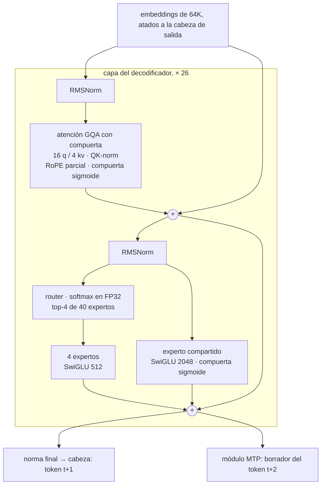
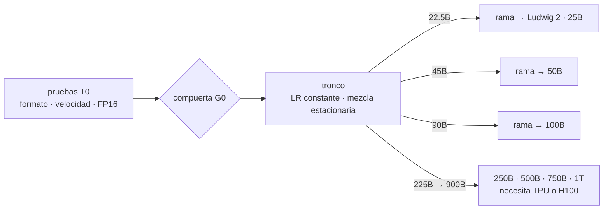

<div align="center">

# Ludwig 2

**Un modelo de lenguaje Mixture-of-Experts de 2B parámetros con 0.49B activos, entrenado desde cero en GPUs gratis de Kaggle y abierto hasta la última línea de log.**


[English](README.md) · **Español**

</div>

> **Estado, 11 de noviembre de 2026.** El diseño está cerrado (v1.1). La prueba de formato (T0.1) pasó, después de encontrar y parchar una caída de llama.cpp. Lo siguiente es la T0.2: velocidad y memoria reales en 2×T4. **Todavía no hay pesos.** Este repositorio documenta el proyecto desde la primera prueba.

## Por qué Ludwig 2

- **Hecho para tu PC.** 0.49B parámetros activos por token, ~1.2 GB en 4 bits y una cabeza MTP para decodificación especulativa en llama.cpp.
- **Entrenado con cómputo gratis.** Dos GPUs T4 de Kaggle, con un relevo entre amigos: cada uno corre sus turnos en su propia cuenta.
- **Inglés y español.** 10% de español en el preentrenamiento y 25–30% en el ajuste fino. [¿Por qué no 4% ni 50%?](#por-qué-10-de-español)
- **Razona, a su escala.** `<think>` desde el día uno, 10–22% de matemática, Python como calculadora y ajuste fino con cadenas de pensamiento cortas.
- **Abierto de punta a punta:** pesos, código, la receta de datos con manifiestos exactos, logs completos, checkpoints intermedios y lo que salió mal.

## El modelo

| | |
|---|---|
| Parámetros | **1.963B totales, 0.491B activos** por token, +75M en la cabeza MTP |
| Forma | 26 capas × ancho 1024 |
| Atención | GQA (16 cabezas de query y 4 de KV, de 64), QK-norm, compuerta sigmoide a la salida, RoPE parcial (50%, θ = 500K) |
| FFN | MoE en todas las capas: 40 expertos (SwiGLU 512), top-4, + 1 experto compartido (SwiGLU 2048) |
| Router | Softmax en FP32, pérdida de balanceo global, sin descartar tokens |
| Vocabulario | 64K, BPE propio, embeddings atados |
| Contexto | 2K → 4K en el tronco, 16K en la v1, 32K desde 250B tokens |
| Decodificación especulativa | 1 módulo MTP, que usa `llama-server --spec-type draft-mtp` |
| Tamaño | ~2.2 GB en Q8_0, ~1.15 GB en Q4_0; caché KV de 26.6 KB por token (436 MB a 16K) |
| Formato | `Qwen3NextForCausalLM` de Hugging Face con las 26 capas en `full_attention` → GGUF |



### Frente a MobileMoE-M

Ludwig 2 toma la forma de MobileMoE-M de Meta y cambia lo que un proyecto gratis y abierto puede cambiar:

| | MobileMoE-M (Meta) | Ludwig 2 |
|---|---|---|
| Forma | 26 × 1024, GQA 16/4 | Igual |
| Totales / activos | 2.82B / 528M | 1.96B / 491M |
| Vocabulario | 128K (Llama 3) | 64K: la cabeza a la mitad |
| QK-norm y compuerta | No las menciona | Las dos |
| Router | Sigmoide sin pérdida auxiliar | Softmax + balanceo global (ver [D03](docs/DECISIONS.md#d03-format-ab)) |
| Optimizador y schedule | AdamW, coseno | Muon, WSD |
| Precisión | BF16 | FP16 (T4) |
| Tokens de entrenamiento | ~6T + 500B de mid-training | 25B (v1) → 1T |
| Contexto | 8K | 16K → 32K |
| Decodificación especulativa | No | MTP |
| Dónde corre | ExecuTorch, con una op propia | transformers y llama.cpp |

Meta entrenó ~260 veces más tokens que nuestra v1. Por eso la v1 se compara por tokens contra checkpoints intermedios públicos (por ejemplo OLMoE y Pythia a ~25B tokens), no de tú a tú con MobileMoE-M.

## Programa de entrenamiento

Un solo tronco con learning rate constante y una mezcla de datos estacionaria. Cada versión pública es una rama corta de enfriamiento que sale del tronco, y el tronco sigue.



| Versión | Tokens nuevos | Horas de 2×T4 | Semanas de relevo |
|---|---|---|---|
| Ludwig 2 · 25B | 25B | 1,750–2,800 | 12–20 |
| Ludwig 2 · 50B | 27.5B | 1,900–3,000 | 13–21 |
| Ludwig 2 · 100B | 55B | 4,200–6,600 | 29–46 |
| 250B → 1T | 1,060B | Fuera del alcance de Kaggle | ~2,100–3,700 h de TPU v5e-8 para el programa completo |

Antes de cada fase nueva tienen que pasar cinco revisiones: la versión anterior publicada, la pérdida de validación en su curva esperada, los expertos sanos, sin memorización en las fuentes que se repiten, y hardware para la fase completa. **1T es una meta, no una obligación**: cada versión hasta 100B se puede publicar por sí sola. Detalles en [`docs/es/DISENO.md`](docs/es/DISENO.md) §7.

## Resultados hasta ahora

### T0.1: formato, MTP y tokenizador (CPU, 11 de noviembre de 2026)

Un modelo diminuto con exactamente la estructura de Ludwig 2 se entrena unos pasos, se exporta, se convierte a GGUF y se compara entre transformers y llama.cpp ([`scripts/smoke_format.py`](scripts/smoke_format.py)).

| Prueba | llama.cpp sin cambios | Con [nuestro parche](patches/README.md) |
|---|---|---|
| A1 Exportar y recargar en transformers | ✅ logits idénticos | ✅ |
| A2 Convertir a GGUF, con el MTP | ✅ | ✅ |
| A3 Probabilidades del siguiente token, llama.cpp contra transformers | ❌ se cae al cargar | ✅ diferencia máx. 1.9e-6 |
| A4 Greedy, token a token | ❌ | ✅ 4/4 idénticos |
| A5 Decodificación especulativa con el MTP | ❌ | ✅ 4/4 idénticos, 64% de borradores aceptados |
| T1–T2 Tokenizador reconocido, mismos tokens que Hugging Face | ✅ | ✅ |

**Lo que encontramos:** llama.cpp trata `qwen3next` como un modelo híbrido aunque ninguna capa sea recurrente, y se cae con un buffer del estado recurrente que nunca se asignó (`GGML_ASSERT(buffer)`). Un parche de 3 líneas lo arregla. Por eso el formato final se decide con datos: un A/B contra el formato de GLM-4.5, que corre sin parches ([D03](docs/DECISIONS.md#d03-format-ab)).

Reportes crudos: [`results/t0_1_stock.json`](results/t0_1_stock.json), [`results/t0_1_patched.json`](results/t0_1_patched.json).

### T0.2: velocidad y memoria en 2×T4

⏳ Lista para correr: [`notebooks/t0_2_velocidad_memoria_2xT4.ipynb`](notebooks/t0_2_velocidad_memoria_2xT4.ipynb). El modelo real de 1.96B con FSDP2, FP16, Muon y las pérdidas reales. Mide tres kernels de MoE, el tamaño del micro-batch, contexto de 2K/4K/16K, el plan B de 32 expertos, el costo del MTP y el guardado y la carga del checkpoint. El diseño estima 12.2–13.6 GiB por GPU, y el plan supone ~2,500–4,000 tokens/s.

## Datos

| | Web en inglés | Código | Matemática | Conocimiento | Libros sintéticos | Español | Instrucción y razonamiento |
|---|---|---|---|---|---|---|---|
| **Tronco** | 50% | 20% | 10% | 5% | 3% | 10% | 2% |
| **Ramas** | 26% | 25% | 22% | 4% | — | 10% | 13% |

- **Fuentes:** FineWeb-Edu y DCLM; Stack-Edu o The Stack v3 (sobre todo Python y JS/TS); FineMath, OpenWebMath y MegaMath; Wikipedia, arXiv y StackExchange; Cosmopedia; FineWeb2 y TransWeb-Edu en español; OpenMathReasoning para las trazas.
- **Licencias:** solo texto humano abierto y salidas de modelos abiertos con licencia permisiva. **Nunca salidas de APIs cerradas.** Los pesos se publican solo después de auditar la ficha de datos fuente por fuente.
- **Datos sintéticos:** con tope de 10% del tronco y 35% de cada rama, de al menos 3 familias de maestros.
- **Descontaminación** contra los benchmarks con filtros de Bloom de 13-gramas; el val de cada fuente nunca se entrena.

### Por qué 10% de español

- **No 50/50.** En experimentos controlados, un idioma dominante ayuda al menos frecuente, y a escala una mezcla 90/10 le ganó a la 50/50 en *los dos* idiomas. Además, el inglés tiene los mejores datos y casi todos los benchmarks.
- **No 4%.** Serían ~1B tokens de español en la v1: muy poco para que converse bien.
- **10%** da ~2.5B tokens de español en la v1 y ~90B a 1T, más o menos 86/14 en lenguaje natural. SmolLM3 usó una proporción parecida (12% multilingüe) y le fue bien en español.
- Se mide con bits por byte en español, MGSM, Belebele, Global-MMLU, HellaSwag y Flores. Si el español se queda atrás, las ramas lo suben sin tocar el tronco.

## Cómo empezar

### Correr las pruebas en tu máquina (CPU)

```bash
git clone https://github.com/<tu-usuario>/ludwig-lm && cd ludwig-lm
pip install -r requirements.txt

# T0.1: la primera vez clona y compila llama.cpp (~15–25 min); después ~1 min por corrida
python scripts/smoke_format.py --patch

# Lógica de FSDP2 + Muon + checkpoint, 2 procesos en CPU con un modelo diminuto
torchrun --nproc_per_node 2 scripts/bench_train.py --config configs/tiny.json \
    --seq 64 --micro 2 --steps 3 --mtp 1.0 --ckpt-test --out /tmp/t0_2_cpu.jsonl
```

### Correrlas en Kaggle

| Notebook | Acelerador | Tiempo | Qué sale |
|---|---|---|---|
| [`t0_1_formato_mtp_tokenizador.ipynb`](notebooks/t0_1_formato_mtp_tokenizador.ipynb) | None (CPU) | ~15–25 min | `results/t0_1_stock.json`, `results/t0_1_patched.json` |
| [`t0_2_velocidad_memoria_2xT4.ipynb`](notebooks/t0_2_velocidad_memoria_2xT4.ipynb) | GPU T4 x2 | ~45–75 min | `results/t0_2.jsonl` |

En cada notebook pon `REPO_URL` con la URL de tu repo (o sube el repo como dataset de Kaggle y déjalo vacío), activa **Internet** y corre todas las celdas. Para tener Internet, la cuenta de Kaggle debe estar verificada con teléfono.

## Repositorio

```
ludwig-lm/
├── ludwig_lm/      # modelo (Qwen3-Next en atención completa + MTP + pérdidas) y el optimizador Muon
├── configs/        # ludwig2.json (el modelo real) y tiny.json (pruebas)
├── scripts/        # smoke_format.py (T0.1), bench_train.py (T0.2), convert_gguf.py, make_notebooks.py
├── notebooks/      # notebooks de Kaggle, generados con scripts/make_notebooks.py
├── patches/        # parche de llama.cpp y su nota técnica
├── results/        # reportes JSON crudos de cada prueba: la evidencia de cada afirmación
└── docs/           # DECISIONS.md (inglés), es/DISENO.md (diseño completo)
```

## Hoja de ruta de la v1

- [x] Diseño v1.1, después de una crítica externa ([`docs/es/DISENO.md`](docs/es/DISENO.md))
- [x] **T0.1** Formato, MTP y tokenizador: pasa con el parche de llama.cpp
- [ ] **T0.1b** Repetir la T0.1 con el tokenizador final de 64K
- [ ] **T0.2** Velocidad y memoria en 2×T4
- [ ] **T0.3** Estabilidad en FP16: 2–3K pasos con el LR pico
- [ ] **T1** Datos: fuente de código, lector determinista con descontaminación y manifiestos
- [ ] **T2** Learning rate (3 corridas cortas) y A/B de formato
- [ ] **G0** Compuerta: ≥6 h sostenidas, guardado, reanudación en otra cuenta, 16K
- [ ] **T3** Tronco hasta 22.5B tokens
- [ ] **T4** Rama de la v1: 2.5B tokens, 16K, MTP
- [ ] **T5** SFT, GGUF y evaluación: **Ludwig 2 · 25B publicado**

## Cómo ayudar

- **Presta horas de T4.** Corre turnos del relevo en *tu propia* cuenta de Kaggle con el notebook del relevo (llega con la T3). Nunca compartas credenciales.
- **Español.** Fuentes de datos, conjuntos de evaluación y revisión de las salidas por hablantes nativos.
- **Motores.** Prueba el GGUF en MLX, vLLM, Ollama o LM Studio cuando exista.
- **Revisión.** Los issues con preguntas o críticas son bienvenidos, y las estrellas también.

## Documentación

- [`docs/es/DISENO.md`](docs/es/DISENO.md): el documento de diseño completo, con números y fuentes.
- [`docs/DECISIONS.md`](docs/DECISIONS.md): cada decisión, por qué y la evidencia (en inglés).
- [`patches/README.md`](patches/README.md): la caída de llama.cpp, su causa y el arreglo (en inglés).

## El nombre

Por Ludwig Boltzmann. Ludwig 2 es el segundo modelo de la familia: Ludwig 1 es un modelo denso de ~200M entrenado con 8B tokens, y Ludwig 2 reutiliza su learning rate y su lector de datos.

## Licencia

Código: [Apache-2.0](LICENSE). Pesos: el plan es Apache-2.0, y se decide en cada versión después de auditar las licencias de los datos.

## Cita

```bibtex
@software{ludwig2_2026,
  author = {García, Felipe},
  title  = {Ludwig 2: a 2B-parameter open MoE language model trained on free GPUs},
  year   = {2026},
  note   = {https://github.com/<tu-usuario>/ludwig-lm}
}
```

## Agradecimientos

Construido sobre [PyTorch](https://pytorch.org), [transformers](https://github.com/huggingface/transformers) y [llama.cpp](https://github.com/ggml-org/llama.cpp). El diseño se apoya en trabajos publicados por Meta (MobileMoE, MobileLLM-R1), Qwen (Qwen3-Next, atención con compuerta), DeepSeek (MTP, R1), Moonshot AI (Muon a escala) y Hugging Face (FineWeb, SmolLM). La lista completa de fuentes está en [`docs/es/DISENO.md`](docs/es/DISENO.md) §13.
