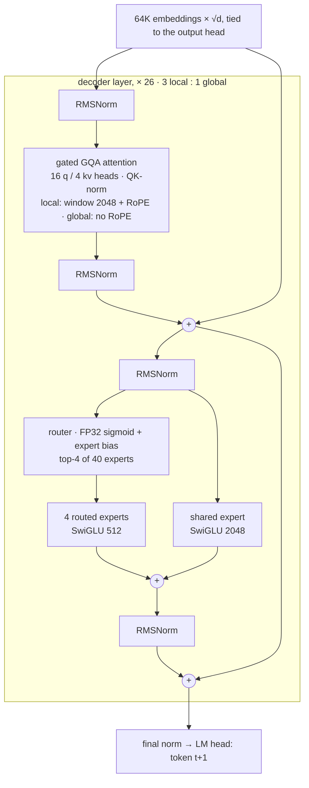
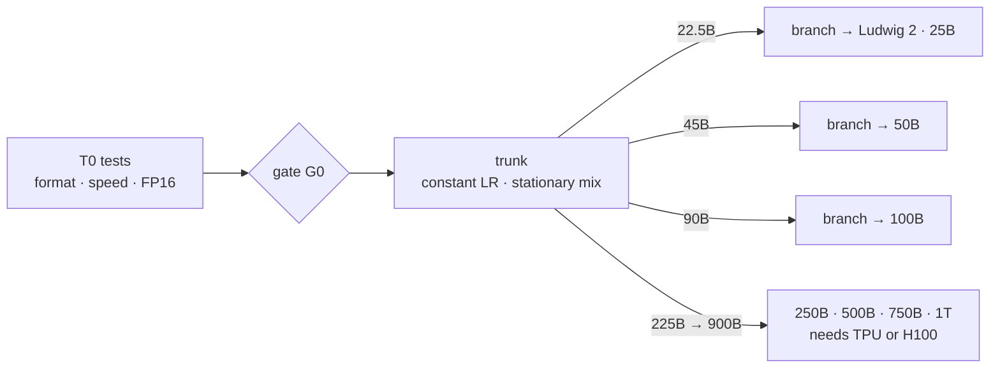

<div align="center">

# Ludwig 2

**A 2B-parameter Mixture-of-Experts language model with 0.49B active parameters, trained from scratch on free Kaggle GPUs and open down to the last log line.**


**English** · [Español](README.es.md)

</div>

> **Status, November 12, 2026.** Design v1.2 is approved: Ludwig 2 is stored in the AFMoE format of Arcee's Trinity models, which runs in llama.cpp unpatched. A first bench on 2×T4 measured **3,856 tokens/s, about 1,800 h for 25B tokens**. Next up is T0.2 v2, the real training stack on 2×T4 ([notebook](notebooks/t0_2v2_afmoe_2xT4.ipynb)). **There are no weights yet.** This repository documents the project from its first test.

## Why Ludwig 2

- **Made for your PC.** 0.49B active parameters per token, ~1.1 GB at 4-bit, and a KV cache 3× smaller than full attention at 16K, because 20 of its 26 layers only look at the last 2,048 tokens.
- **Trained on free compute.** Two T4 GPUs on Kaggle, relayed between friends who each run turns on their own account.
- **English and Spanish.** 10% Spanish in pretraining and 25–30% in fine-tuning. [Why not 4% or 50%?](#why-10-spanish)
- **Reasons, at its scale.** `<think>` from day one, 10–22% math, Python as a calculator, and short chain-of-thought fine-tuning.
- **Open all the way:** weights, code, the data recipe with exact manifests, full training logs, intermediate checkpoints, and the things that went wrong.

## The model

| | |
|---|---|
| Parameters | **1.906B total, 0.491B active** per token |
| Shape | 26 layers × width 1024: the first is dense, the other 25 are MoE |
| Attention | GQA (16 query / 4 KV heads of 64), QK-norm, sigmoid output gate |
| Local and global layers | 3 local layers (sliding window of 2,048 tokens, RoPE θ = 10K) per global layer (no positional encoding): 20 local, 6 global |
| Feed-forward | 40 routed experts (SwiGLU 512), top-4, + 1 shared expert (SwiGLU 2048). The dense first layer is a SwiGLU 4096 |
| Router | Sigmoid in FP32 with an expert bias updated by SMEBU (no auxiliary loss needed for balance), plus a small sequence-wise loss. No token dropping |
| Norms | Depth-scaled sandwich norm: an RMSNorm before and after every sublayer |
| Vocabulary | 64K, own BPE, tied embeddings (scaled by √d at the input) |
| Context | 2K → 4K in the trunk, 16K in v1, 32K from 250B tokens |
| Size | ~2.0 GB in Q8_0, ~1.1 GB in Q4_0. KV cache 136 MiB at 16K, against 416 MiB if every layer were global |
| Format | Hugging Face `AfmoeForCausalLM` (Arcee Trinity) → GGUF with stock llama.cpp |



### Where it comes from

Ludwig 2 takes its **shape** from Meta's MobileMoE-M (deep and thin) and its **block** from Arcee's Trinity Nano, a 6B-total, 1B-active MoE with the same width of 1024, trained with Muon on 10T tokens. Against MobileMoE-M:

| | MobileMoE-M (Meta) | Ludwig 2 |
|---|---|---|
| Shape | 26 × 1024, GQA 16/4 | Same |
| Total / active | 2.82B / 528M | 1.91B / 491M |
| Vocabulary | 128K (Llama 3) | 64K, half the head |
| QK-norm, output gate | Not mentioned | Both |
| Router | Sigmoid, no auxiliary loss | Sigmoid with an expert bias updated by SMEBU |
| Optimizer, schedule | AdamW, cosine | Muon, WSD |
| Precision | BF16 | FP16 (T4) with an FP32 residual stream |
| Training tokens | ~6T + 500B mid-training | 25B (v1) → 1T |
| Context | 8K | 16K → 32K |
| Runs in | ExecuTorch, custom op | transformers and stock llama.cpp |

Meta trained ~260 times more tokens than our v1, so Ludwig 2 v1 will be compared token for token with public intermediate checkpoints (for example OLMoE and Pythia at ~25B tokens), not head to head with MobileMoE-M.

## Training program

One trunk with a constant learning rate and a stationary data mix. Each public version is a short cooldown branch off the trunk, and the trunk keeps going.



| Version | New tokens | 2×T4 hours | Weeks of relay |
|---|---|---|---|
| Ludwig 2 · 25B | 25B | 1,750–2,800 | 12–20 |
| Ludwig 2 · 50B | 27.5B | 1,900–3,000 | 13–21 |
| Ludwig 2 · 100B | 55B | 4,200–6,600 | 29–46 |
| 250B → 1T | 1,060B | Out of Kaggle's reach | ~2,100–3,700 h of TPU v5e-8 for the full program |

Before each new phase, five checks must pass: previous version published, validation loss on its expected curve, healthy experts, no memorization in repeated sources, and hardware for the whole phase. **1T is a goal, not an obligation**: every version up to 100B is publishable on its own. Details in [`docs/es/DISENO.md`](docs/es/DISENO.md) §7.

## Results so far

### T0.1: the first format (CPU, November 11, 2026)

v1.1 stored the model as `Qwen3NextForCausalLM` with every layer in full attention (format A). A tiny model in that format converts to GGUF, but **stock llama.cpp crashes on load**: it treats `qwen3next` as a hybrid model even when no layer is recurrent, and asserts on a buffer that was never allocated (`GGML_ASSERT(buffer)`). With a 3-line patch everything passes: probabilities within 1.9e-6, greedy 4/4, MTP speculative decoding 4/4 ([`patches/README.md`](patches/README.md), [`results/t0_1_stock.json`](results/t0_1_stock.json), [`results/t0_1_patched.json`](results/t0_1_patched.json)). A model that only runs on a patched llama.cpp does not run in Ollama or LM Studio, so v1.2 moved to a format that needs no patch.

### Bench v1: speed and memory on 2×T4 (Kaggle, November 11, 2026)

A separate PyTorch implementation of the same shape ([`results/banco_t4_v1/banco_t4_v1.py`](results/banco_t4_v1/banco_t4_v1.py)), with FSDP2, FP16 and Muon, run on random data and a short synthetic training:

| | Result |
|---|---|
| 26 × 1024, 40 experts, 8 sequences of 2K per GPU | **3,856 tokens/s**, peak 13.2 GiB (13.8 reserved), **1,801 h for 25B tokens** |
| Wider shapes (16 × 1280, 11 × 1536, 6 × 2048) | At most 1.11× faster: depth stays |
| 48 / 60 experts | −24% / −31% speed: 40 stays |
| Bandwidth between the two T4s | 3.2 GB/s |
| 60 FP16 training steps | Loss 11.27 → 1.79, no skipped steps, no NaN; but the busiest expert reached 8.4× the mean load |

Raw output: [`results/banco_t4_v1/`](results/banco_t4_v1/). What it settles and what it does not: [`docs/es/BITACORA.md`](docs/es/BITACORA.md).

### T0.1-C: the AFMoE format (CPU, November 11, 2026)

A tiny `AfmoeForCausalLM` with Ludwig 2's layout, run with prompts longer than its sliding window and a deliberately large expert bias, matches transformers on **stock** llama.cpp: next-token probabilities within 5.9e-5, greedy 4/4, expert bias respected ([`scripts/smoke_format_afmoe.py`](scripts/smoke_format_afmoe.py), [`results/t0_1c_afmoe.json`](results/t0_1c_afmoe.json)). Two settings are mandatory for that: `mup_enabled` (llama.cpp always scales the embeddings by √d) and `route_norm`.

### T0.2 v2: the real training stack on 2×T4

⏳ Ready to run: [`notebooks/t0_2v2_afmoe_2xT4.ipynb`](notebooks/t0_2v2_afmoe_2xT4.ipynb), ~1–1.25 h. It trains the real 1.906B model in the transformers class plus our speed pieces: padded-bmm experts, FP32 residual stream, FP16 gradients between the GPUs, FSDP2 prefetch, and Muon's momentum in CPU RAM as an option. Each piece is switched off once to measure what it is worth. It also measures 4K and 16K context, a full checkpoint save and load, and 60 training steps that compare SMEBU with the fixed-sign bias update.

## Data

| | English web | Code | Math | Knowledge | Textbooks | Spanish | Instructions and reasoning |
|---|---|---|---|---|---|---|---|
| **Trunk** | 50% | 20% | 10% | 5% | 3% | 10% | 2% |
| **Branches** | 26% | 25% | 22% | 4% | — | 10% | 13% |

- **Sources:** FineWeb-Edu and DCLM; Stack-Edu or The Stack v3 (mostly Python and JS/TS); FineMath, OpenWebMath and MegaMath; Wikipedia, arXiv and StackExchange; Cosmopedia; FineWeb2 and TransWeb-Edu in Spanish; OpenMathReasoning for traces.
- **Licenses:** open human text and outputs of permissively licensed open models only. **Never outputs of closed APIs.** Weights are released only after a source-by-source audit of the data card.
- **Synthetic data:** capped at 10% of the trunk and 35% of each branch, from at least 3 teacher families.
- **Decontamination** against the benchmarks with 13-gram Bloom filters; the validation split of each source is never trained on.

### Why 10% Spanish

- **Not 50/50.** In controlled studies a dominant language helps the less frequent one, and at scale a 90/10 mix beat 50/50 in *both* languages. English also has the best data and nearly all benchmarks.
- **Not 4%.** That would be ~1B Spanish tokens in v1: too little to hold a conversation.
- **10%** gives ~2.5B Spanish tokens in v1 and ~90B at 1T, about 86/14 in natural language. SmolLM3 used a similar share (12% multilingual) and did well in Spanish.
- It is measured with Spanish bits per byte, MGSM, Belebele, Global-MMLU, HellaSwag and Flores. If Spanish lags, the branches raise it without touching the trunk.

## Quick start

### Run the tests on your machine (CPU)

```bash
git clone https://github.com/FelipeGarciaRpo/ludwig-lm && cd ludwig-lm
pip install -r requirements.txt

# T0.1-C: the AFMoE format against llama.cpp (clones and builds llama.cpp the first time, ~15–25 min)
python scripts/smoke_format_afmoe.py

# The training stack (FSDP2, Muon, balancing, checkpoint), 2 processes on CPU with a tiny model
torchrun --nproc_per_node 2 scripts/bench_afmoe.py --config configs/tiny_afmoe.json \
    --seq 64 --micro 2 --steps 2 --ckpt-test --out /tmp/t0_2v2_cpu.jsonl
```

### Run them on Kaggle

| Notebook | Accelerator | Time | What you get |
|---|---|---|---|
| [`t0_2v2_afmoe_2xT4.ipynb`](notebooks/t0_2v2_afmoe_2xT4.ipynb) | GPU T4 x2 | ~1–1.25 h | `results/t0_2v2.jsonl` |
| [`t0_1_formato_mtp_tokenizador.ipynb`](notebooks/t0_1_formato_mtp_tokenizador.ipynb) | None (CPU) | ~15–25 min | Format A and **tokenizer** checks; only the tokenizer part still matters |

In each notebook set `REPO_URL` to your clone (or upload the repo as a Kaggle dataset and leave it empty), turn **Internet on**, and run all cells. Internet access requires a phone-verified Kaggle account. `t0_2_velocidad_memoria_2xT4.ipynb` measured format A and is kept only as a record.

## Repository

```
ludwig-lm/
├── ludwig_lm/      # afmoe.py: the model (AFMoE), its kernel, losses and balancer · muon.py · model.py: format A (fallback)
├── configs/        # ludwig2_afmoe.json (the real model), tiny_afmoe.json (tests); ludwig2.json, tiny.json (format A)
├── scripts/        # smoke_format_afmoe.py (T0.1-C), bench_afmoe.py (T0.2 v2), make_notebooks.py, convert_gguf.py, format-A tools
├── notebooks/      # Kaggle notebooks, generated by scripts/make_notebooks.py
├── patches/        # llama.cpp patch for format A and its technical note
├── results/        # raw reports of every test: the evidence behind each claim
└── docs/           # DECISIONS.md (English), es/DISENO.md (full design), es/BITACORA.md (log of every run)
```

## Roadmap to v1

- [x] Design v1.1, after an external critique ([`docs/es/DISENO.md`](docs/es/DISENO.md))
- [x] **T0.1** Format A: crashes stock llama.cpp, passes with a patch
- [x] **Bench v1** on 2×T4: 3,856 tokens/s, shape and expert count confirmed
- [x] **T0.1-C** AFMoE format: passes on stock llama.cpp
- [x] **v1.2** AFMoE format approved
- [ ] **T0.2 v2** The real training stack on 2×T4 ([notebook](notebooks/t0_2v2_afmoe_2xT4.ipynb))
- [ ] **T0.1b** Re-run the tokenizer checks with the final 64K tokenizer
- [ ] **T0.3** FP16 stability: 2–3K steps at peak LR
- [ ] **T1** Data: code source, deterministic loader with decontamination and manifests
- [ ] **T2** Learning rate: 3 short runs
- [ ] **G0** Gate: ≥6 h sustained, save, resume on another account, 16K
- [ ] **T3** Trunk to 22.5B tokens
- [ ] **T4** v1 branch: 2.5B tokens, 16K
- [ ] **T5** SFT, GGUF, evaluation: **Ludwig 2 · 25B released**

## How to help

- **Lend T4 hours.** Run relay turns on *your own* Kaggle account with the relay notebook (coming with T3). Never share credentials.
- **Spanish.** Data sources, evaluation sets, and native-speaker review of the outputs.
- **Runtimes.** Test the GGUF in MLX, vLLM, Ollama or LM Studio once it exists.
- **Review.** Issues with questions or criticism are welcome, and so are stars.

## Documentation

- [`docs/DECISIONS.md`](docs/DECISIONS.md): every decision, why, and the evidence behind it (English).
- [`docs/es/DISENO.md`](docs/es/DISENO.md): the full design document with numbers and sources (Spanish).
- [`docs/es/BITACORA.md`](docs/es/BITACORA.md): every run and decision, in order (Spanish).
- [`patches/README.md`](patches/README.md): the llama.cpp crash with format A, its cause, and the fix.

## The name

After Ludwig Boltzmann. Ludwig 2 is the second model of the family: Ludwig 1 is a ~200M dense model trained on 8B tokens, and Ludwig 2 reuses its learning rate and data loader.

## License

Code: [Apache-2.0](LICENSE). Weights: Apache-2.0 is the plan, decided per release after the data-license audit.

## Citation

```bibtex
@software{ludwig2_2026,
  author = {García, Felipe},
  title  = {Ludwig 2: a 2B-parameter open MoE language model trained on free GPUs},
  year   = {2026},
  note   = {https://github.com/FelipeGarciaRpo/ludwig-lm}
}
```

## Acknowledgements

Built on [PyTorch](https://pytorch.org), [transformers](https://github.com/huggingface/transformers) and [llama.cpp](https://github.com/ggml-org/llama.cpp). The design leans on published work by Meta (MobileMoE, MobileLLM-R1), Arcee (Trinity and its AFMoE block), Qwen (gated attention), DeepSeek (aux-loss-free balancing, R1), Moonshot AI (Muon at scale) and Hugging Face (FineWeb, SmolLM). The full source list is in [`docs/es/DISENO.md`](docs/es/DISENO.md) §13.
